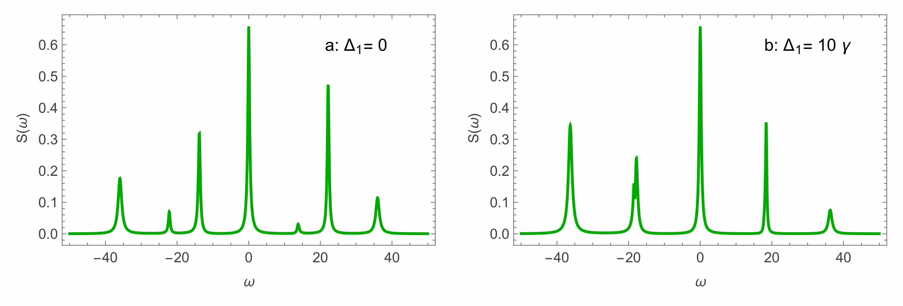
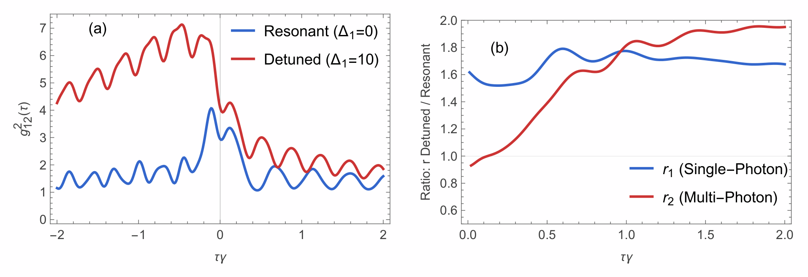
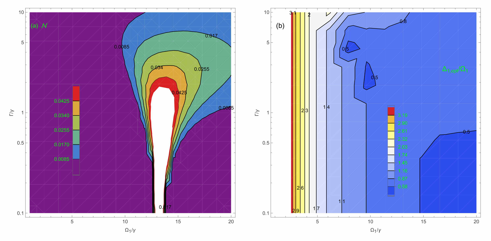

# Numerical Datasets: Continuous Generation of Frequency-Entangled Photon Pairs in a Driven Three-Level $\Lambda$ System

This repository provides numerical datasets and publication figures supporting the manuscript:
> **Continuous Generation of Frequency-Entangled Photon Pairs in the Resonance Fluorescence of a Driven Three-Level $\Lambda$ System**  
> *Tushar Kanti Dey and Surajit Sen*

---

## Physical Parameters & Conventions

All physical quantities are expressed in dimensionless units scaled by the primary spontaneous decay rate $\gamma \equiv \Gamma_{32}$:
- **Spontaneous decay rates:** $\Gamma_{31} = 0.1\,\gamma$, $\Gamma_{32} = 1.0\,\gamma \equiv \gamma$
- **Rabi driving frequencies:** $\Omega_1 = 14\,\gamma$, $\Omega_2 = 10\,\gamma$ (unless varied as a coordinate)
- **Two-photon Raman detuning:** $\delta = \Delta_1 - \Delta_2 = 10\,\gamma$
- **Filter cavity bandwidths:** $\Gamma_1 = \Gamma_2 = \Gamma$
- **Dimensionless time delay:** $\tau\gamma$ (where $\gamma^{-1}$ sets the radiative lifetime)
- **Dimensionless frequency:** $\omega/\gamma$

---

## Datasets

All files contain headerless, comma-separated floating-point values corresponding to the figures in the manuscript:

| File | Description | Corresponding Figure | Data Format |
| :--- | :--- | :--- | :--- |
| `spectrumdelta10.csv` | Incoherent fluorescence power spectrum $S(\omega)$ at resonance ($\Delta_1 = 0$) | **Fig. 2(a)** | **Col 1:** $\omega/\gamma \in [-50, 50]$ (step $0.2$)<br>**Col 2:** $S(\omega)$ |
| `spectrumdelta110.csv` | Incoherent fluorescence power spectrum $S(\omega)$ with detuning ($\Delta_1 = 10\,\gamma$) | **Fig. 2(b)** | **Col 1:** $\omega/\gamma \in [-50, 50]$ (step $0.2$)<br>**Col 2:** $S(\omega)$ |
| `g2resonance.csv` | Cross-correlation $g_{12}^{(2)}(\tau)$ at resonance ($\Delta_1 = 0$) | **Fig. 4(a)** (resonant, blue) | **Col 1:** $\tau\gamma \in [-2.0, 2.0]$ (step $0.01$)<br>**Col 2:** $g_{12}^{(2)}(\tau)$ |
| `g2detuned.csv` | Cross-correlation $g_{12}^{(2)}(\tau)$ with detuning ($\Delta_1 = 10\,\gamma$) | **Fig. 4(a)** (detuned, red) | **Col 1:** $\tau\gamma \in [-2.0, 2.0]$ (step $0.01$)<br>**Col 2:** $g_{12}^{(2)}(\tau)$ |
| `negativity.csv` | Logarithmic negativity $\mathcal{N}$ across drive and filter space | **Fig. 5(a)** (contour plot) | **Col 1:** $\Omega_1/\gamma \in [1, 20]$<br>**Col 2:** $\Gamma/\gamma \in [0.1, 10]$<br>**Col 3:** $\mathcal{N}$ |
| `optimumDelta1.csv` | Optimal single-photon detuning ratio $\Delta_{1,\text{opt}}/\Omega_1$ | **Fig. 5(b)** (contour plot) | **Col 1:** $\Omega_1/\gamma \in [1, 20]$<br>**Col 2:** $\Gamma/\gamma \in [0.1, 10]$<br>**Col 3:** $\Delta_{1,\text{opt}}/\Omega_1$ |

---

## Publication Figures

High-resolution vector (`.pdf`) and raster preview (`.png`) graphics are available in the [`figures/`](figures/) directory:

### Figure 2: Fluorescence Power Spectrum
*Incoherent fluorescence power spectrum $S(\omega)$ for the $|3\rangle \to |1\rangle$ transition. (a) Resonant driving $\Delta_1 = 0$. (b) Detuned driving $\Delta_1 = 10\,\gamma$. Emitted fluorescence vanishes when $\delta = 0$ due to Coherent Population Trapping (CPT).*



### Figure 4: Second-Order Cross-Correlation & Heralding Efficiency
*(a) Frequency-filtered cross-correlation $g_{12}^{(2)}(\tau)$ demonstrating causal time-ordering asymmetry and delayed antibunching dip ($\tau > 0$). (b) Heralding efficiency $r$-curves: single-photon enhancement ($r_1 > 1$) and multi-photon suppression ($r_2 < 1$).*



### Figure 5: Logarithmic Negativity & Optimal Detuning
*(a) Logarithmic negativity $\mathcal{N}$ displaying vertical contours robust against detector broadening $\Gamma/\gamma$. (b) Optimal single-photon detuning ratio $\Delta_{1,\text{opt}}/\Omega_1$ maximizing bipartite entanglement.*



### Supplementary Diagrams
- **[Figure 1: System Diagram](figures/threeleveldiagram.pdf):** Driven three-level $\Lambda$ emitter coupled unidirectionally to frequency-filtered detector cavities.
- **[Figure 3: Dressed-State Ladder](figures/threeleveldressedstate.pdf):** Dressed states and virtual-state leapfrog pair emission mechanism.

---

## Data Loading

### Python (pandas)
```python
import pandas as pd

# 1. Incoherent fluorescence power spectrum S(omega)
spec_res = pd.read_csv("spectrumdelta10.csv", header=None, names=["omega_gamma", "S_omega"])
spec_det = pd.read_csv("spectrumdelta110.csv", header=None, names=["omega_gamma", "S_omega"])

# 2. Two-time cross-correlation g12^(2)(tau)
g2_res = pd.read_csv("g2resonance.csv", header=None, names=["tau_gamma", "g2"])
g2_det = pd.read_csv("g2detuned.csv", header=None, names=["tau_gamma", "g2"])

# 3. Entanglement and optimal detuning grids
negativity = pd.read_csv("negativity.csv", header=None, names=["Omega1_gamma", "Gamma_gamma", "negativity"])
opt_delta  = pd.read_csv("optimumDelta1.csv", header=None, names=["Omega1_gamma", "Gamma_gamma", "opt_Delta1_ratio"])
```

### Wolfram Mathematica
```mathematica
(* 1. Incoherent fluorescence power spectrum *)
specRes = Import["spectrumdelta10.csv"];
specDet = Import["spectrumdelta110.csv"];
ListLinePlot[{specRes, specDet}, 
  PlotLegends -> {"\[CapitalDelta]1 = 0", "\[CapitalDelta]1 = 10\[Gamma]"}, 
  AxesLabel -> {"\[Omega]/\[Gamma]", "S(\[Omega])"}]

(* 2. Two-time cross-correlation *)
g2Res = Import["g2resonance.csv"];
g2Det = Import["g2detuned.csv"];
ListLinePlot[{g2Res, g2Det}, 
  PlotLegends -> {"Resonant", "Detuned"}, 
  AxesLabel -> {"\[Tau]\[Gamma]", "Subscript[g, 12]^(2)(\[Tau])"}]

(* 3. Negativity contour grid *)
negativity = Import["negativity.csv"];
ListContourPlot[negativity, 
  ScalingFunctions -> {Identity, "Log"}, 
  AxesLabel -> {"Subscript[\[CapitalOmega], 1]/\[Gamma]", "\[CapitalGamma]/\[Gamma]"}]
```

---

## Citation & Contact

If you use these datasets or figures in your research, please cite:
```bibtex
@article{dey2026frequency,
  title={Continuous Generation of Frequency-Entangled Photon Pairs in the Resonance Fluorescence of a Driven Three-Level $\Lambda$ System},
  author={Dey, Tushar Kanti and Sen, Surajit},
  year={2026}
}
```

For correspondence regarding the theoretical model or datasets:
- **Tushar Kanti Dey**: `tkdey54@gmail.com`
